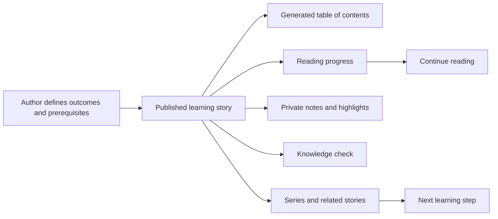
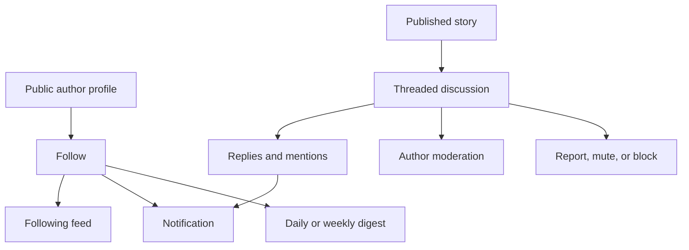

# Learning and Community Architecture

This document records the Inkwell features introduced in roadmap Phases 3 and 4.

## Learning journey

Second- and third-level Markdown headings become stable table-of-contents links. Signed-in readers periodically synchronize normalized progress between zero and one. Reopening an unfinished story restores the approximate reading position, and `/learning/continue` lists unfinished work.

Private notes belong to both a user and a story. They may contain a selected quotation, but they are never returned by public story endpoints. Quiz responses store the selected option and correctness so future reporting can measure learning without exposing private notes.

Authors can attach stories to ordered series and define outcomes, prerequisites, difficulty, external references, and the date the material was last reviewed. Related stories use shared topics; series order provides the deliberate prerequisite/next-step path.

## Community journey

Profiles have stable usernames, biography and professional context, optional avatar/location/website fields, follower counts, and a public archive of published work. Existing accounts can adopt a username through profile settings; new accounts receive a unique starter username.

Comments support one visible reply level in the interface while retaining parent relationships in the database. The story author or comment author may remove a comment. `@username` tokens create in-app mention notifications. Follows, comments, replies, and mentions create notifications.

Mute hides a person's comments and feed content for the acting reader. Block removes follow relationships and prevents new discussion interactions between both accounts. Reports are immutable moderation records with a reason and optional details.

## Email digest delivery

Readers choose `off`, `daily`, or `weekly`. The Worker cron gathers recent stories from followed authors and sends an authenticated `learning_digest` payload to `DIGEST_WEBHOOK_URL`. Set `DIGEST_WEBHOOK_TOKEN` when the receiving email service requires bearer authentication. Successful delivery advances `lastDigestAt`; failures are logged and retried on a later cron run.

No provider credential or vendor-specific API is committed to the repository. Production must connect the webhook to the chosen transactional email provider.

## Main endpoints

- `/api/v1/learning/series/*` — author series management
- `/api/v1/learning/stories/:postId/progress` — private reading progress
- `/api/v1/learning/continue` — unfinished reading library
- `/api/v1/learning/stories/:postId/notes` — private notes/highlights
- `/api/v1/learning/quiz/:questionId/attempt` — answer evaluation
- `/api/v1/community/profile/*` — profiles and author archives
- `/api/v1/community/posts/:postId/comments` — public discussions
- `/api/v1/community/notifications` — private notification inbox
- `/api/v1/community/users/:id/block` and `/mute` — relationship safety
- `/api/v1/community/reports` — safety reports

## Operational requirements

- Apply both `20261011180000_learning_and_community` and `20261011183000_digest_delivery_and_constraints`.
- Deploy the Worker before deploying the updated frontend.
- Keep the five-minute Worker cron enabled for scheduled publication and digest delivery.
- Configure the optional digest webhook variables before expecting email delivery.
- Complete the production smoke-test checklist in `PROJECT_STATUS.md` after deployment.
