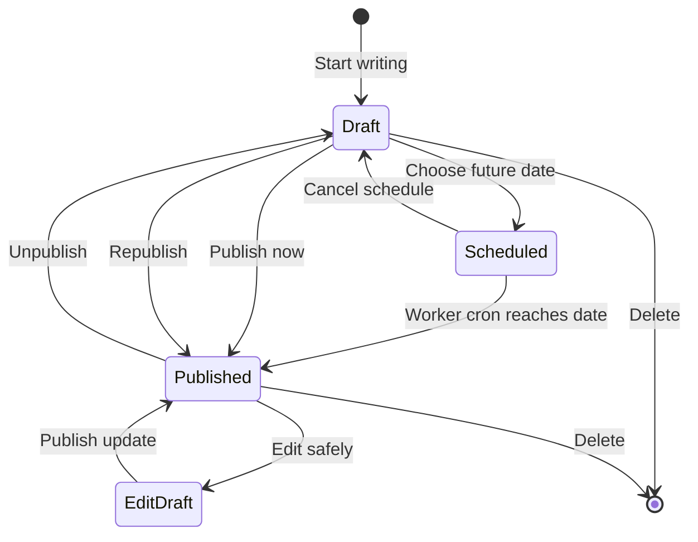

# Phase 2 Publishing Workflow

This document records the complete Inkwell publishing architecture implemented through roadmap Phase 2.

## Content format

Stories are stored as Markdown in `Post.content`, with `Post.contentFormat` set to `markdown`. Markdown keeps content portable and supports:

- Headings
- Bold and italic text
- Links
- Ordered and unordered lists
- Quotations
- Inline and fenced code
- Images, alternative text, and captions

The React reader uses `react-markdown` with GitHub-Flavored Markdown support. Raw HTML is not enabled. The Worker has a separate escaped Markdown renderer for server-rendered canonical pages. User input is never inserted into Worker-generated HTML without escaping or URL-protocol validation.

## Story lifecycle

### New stories

A new story begins as an account-synced draft. Publishing assigns its readable slug and publication timestamp. Scheduling assigns a future timestamp; the Cloudflare Worker cron checks due stories every five minutes.

### Editing published stories safely

Editing a published story creates or reuses a private edit draft linked through `sourcePostId`. Autosave changes the edit draft rather than the live story. Publishing the update:

1. Saves the current published story as a revision.
2. Copies the edit draft fields into the published story.
3. Preserves the canonical story ID, slug, and original publication time.
4. Deletes the completed edit draft.

This prevents partially written changes from appearing publicly.

### Revisions

`PostRevision` stores snapshots of the title, summary, Markdown, topics, cover image, and accessibility text. Revisions are created before a published update, unpublish operation, or revision restore. Restoring a revision first snapshots the current version, so restoration is reversible.

### Duplication

Any owned story can be duplicated into an independent draft. It receives a new ID and private draft slug and has no relationship to the original publishing lifecycle.

## Media pipeline

The browser accepts JPEG, PNG, and WebP files up to 12 MB. Before upload it:

1. Decodes the image.
2. Limits its longest side to 1,800 pixels.
3. Converts it to WebP at 82% quality.
4. Requires meaningful alternative text.

The Worker validates the encoded media again, enforces a 3 MB processed limit, stores it in `MediaAsset`, and serves it from immutable `/media/:id` URLs with `nosniff` protection. Cover images feed both the reader design and Open Graph/Twitter metadata. A generated default preview bitmap is used when a story has no cover.

The database-backed media implementation is deliberately self-contained. At larger traffic volumes, migrate binary data to Cloudflare R2 while retaining the same public URL contract.

## Autosave and leaving protection

- Every change is immediately copied to local storage.
- Changes are debounced and synchronized to the account after 900 ms.
- The browser warns before unloading while unsynchronized changes exist.
- Successful server synchronization clears the dirty state.
- The local copy remains a fallback when the API is unavailable.

## Preview and rendering

The editor preview uses the same React Markdown component as the public reader. Direct canonical `/story/:slug` requests are rewritten by Vercel to `/render/:slug` on the Worker, which returns complete article HTML, canonical metadata, Open Graph and Twitter fields, and JSON-LD. Client-side navigation retains the interactive React reader.

## Operational requirements

- Apply `20261011100000_complete_publishing_workflow` before deploying the Worker.
- Deploy the Worker before the frontend so new API routes exist when the editor becomes available.
- Keep the Worker cron trigger enabled.
- Set `FRONTEND_URL` to the exact production frontend origin.
- Optionally configure `ERROR_MONITOR_URL` and `ERROR_MONITOR_TOKEN` for external error delivery.
- Monitor PostgreSQL storage while media remains database-backed.
