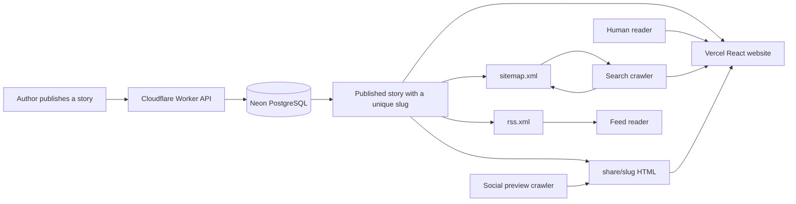
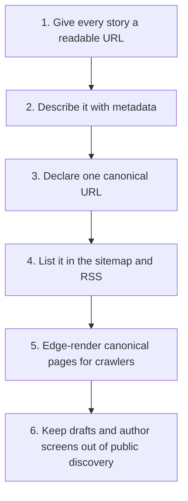
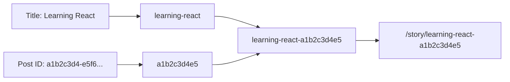
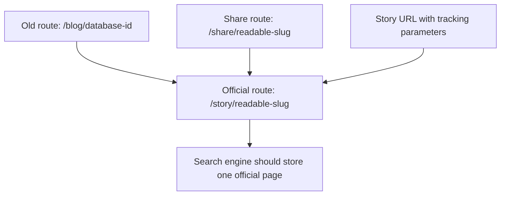
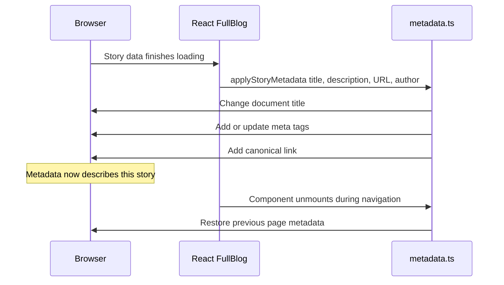
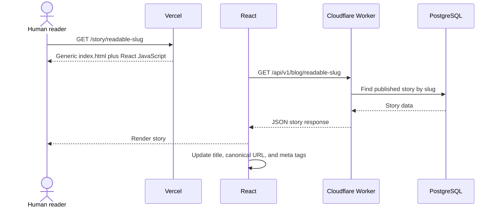
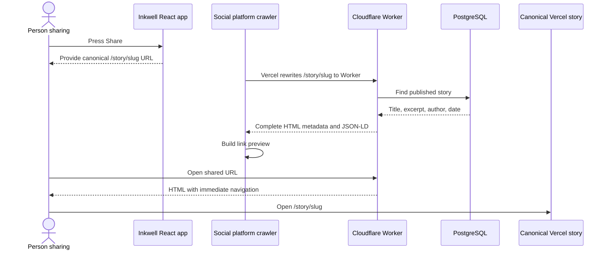
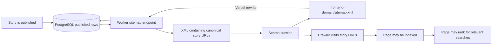
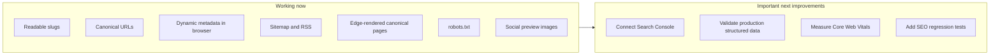

# SEO in Inkwell: A Beginner's Guide to Our Implementation

This guide explains search engine optimization (SEO) from first principles and connects every concept to the code that implements it in Inkwell. It is written for someone who does not already know SEO terminology.

> **How to view the diagrams:** Open this file on GitHub or in a Markdown preview that supports Mermaid. If you open it as plain text, the diagrams appear as `mermaid` code blocks instead of pictures.

## 0. Start here: the simplest explanation

Imagine that Inkwell is a library and every published story is a book:

| Website concept            | Library equivalent                      | What it does                                                |
| -------------------------- | --------------------------------------- | ----------------------------------------------------------- |
| Published story            | A book on a shelf                       | The useful information a reader wants                       |
| Story URL                  | The book's shelf address                | Gives the story one place where it can be found             |
| Slug                       | A readable label on the shelf           | Makes the address understandable                            |
| Page title and description | The book's title and back-cover summary | Tell people and machines what the story is about            |
| Sitemap                    | The library catalog                     | Lists the public stories that exist                         |
| Search crawler             | A librarian building a catalog          | Visits stories and records what they contain                |
| Search index               | The library's searchable database       | Stores known pages for future searches                      |
| Search ranking             | The order of recommended books          | Decides which result appears first                          |
| `robots.txt`               | A “staff only” sign                     | Asks crawlers not to visit authoring screens                |
| Canonical URL              | The official shelf location             | Prevents several addresses being treated as different books |

Our code does not “put a story at number one on Google.” It prepares each published story so search engines can find it, understand it, and know its official address.

### The whole system in one picture



Read this diagram from left to right:

1. An author publishes through the Worker API.
2. PostgreSQL stores the story, including its slug and publication state.
3. The same published data powers the website, sitemap, RSS feed, and share page.
4. Humans, search crawlers, social crawlers, and feed readers enter through different paths.

### The six things we implemented



If the rest of this guide feels too detailed, remember those six steps. Everything below explains how each one works.

## 1. What SEO actually means

**SEO**, or **search engine optimization**, is the work of making public web content easy for search engines to:

1. **Discover** — find that a page exists.
2. **Crawl** — request and read the page.
3. **Understand** — identify its title, subject, author, publication date, and relationship to other pages.
4. **Index** — store the page in the search engine's searchable database.
5. **Rank** — decide when and where it should appear for a search query.

Technical SEO helps with the first four steps and removes barriers to ranking. It does **not** guarantee a high position. Ranking also depends on content quality, originality, usefulness, reputation, links from other sites, user intent, performance, accessibility, and competition.

### The important actors

- A **reader** is a person using a browser.
- A **crawler**, **spider**, or **bot** is automated software that requests pages and follows links. Googlebot is an example.
- A **social crawler** is a bot used by services such as LinkedIn, Facebook, or messaging applications to build a link preview.
- A **feed reader** is an application that periodically reads an RSS document to discover new articles.

These clients do not all behave the same way. A browser executes JavaScript. Some search crawlers can execute JavaScript, often later in a separate rendering step. Many social crawlers read only the first HTML response and do not execute the React application. That difference strongly influences our design.

## 2. The three SEO flows in Inkwell

```mermaid
flowchart TB
    subgraph HumanFlow["A human reads a story"]
        H1["Open /story/my-title-abc123"] --> H2["Vercel returns the React app"]
        H2 --> H3["React asks the Worker for story data"]
        H3 --> H4["React shows the story and changes metadata"]
    end

    subgraph SearchFlow["A search engine discovers stories"]
        G1["Request /sitemap.xml"] --> G2["Vercel passes request to Worker"]
        G2 --> G3["Worker reads published stories from database"]
        G3 --> G4["Crawler receives a list of story URLs"]
    end

    subgraph SocialFlow["A social service creates a preview"]
        S1["Request /story/my-title-abc123"] --> S2["Vercel rewrites to Worker-rendered HTML"]
        S2 --> S3["Service creates title and description preview"]
        S2 --> S4["Human is sent to canonical story page"]
    end
```



This is a hybrid solution: in-app navigation uses the interactive React reader, while direct canonical story requests, the sitemap, RSS feed, and share metadata are rendered by the Worker.

## 3. URLs, slugs, and canonical URLs

### URL

A **URL** is the complete address of a resource, for example:

```text
https://inkwell.example/story/how-to-learn-typescript-a1b2c3d4e5
```

Its main parts are:

- `https` — the protocol.
- `inkwell.example` — the host or domain.
- `/story/how-to-learn-typescript-a1b2c3d4e5` — the path.

### Slug

A **slug** is the readable final part of a page path. In the example above, the slug is:

```text
how-to-learn-typescript-a1b2c3d4e5
```

Readable slugs help people understand a link and give crawlers useful context. They are not a major ranking trick by themselves, but they improve clarity and link quality.

The `Post` model stores a required, unique slug in `backend/prisma/schema.prisma`:

```prisma
slug String @unique
```

The migration `backend/prisma/migrations/20261010120000_story_slugs_and_drafts/migration.sql` added `slug` and `publishedAt`. Existing posts initially received their ID as a safe slug so the migration would not break old data.

`createStorySlug` in `backend/src/blog-utils.ts` creates new readable slugs. It:

1. Normalizes accented characters.
2. Converts the title to lowercase.
3. Replaces groups of non-alphanumeric characters with `-`.
4. Removes leading and trailing hyphens.
5. Limits the readable title portion to 72 characters.
6. Appends ten characters from the unique post ID.

Appending part of the ID prevents two stories with the same title from receiving the same slug. For example, two posts called “Learning React” can still have different URLs.



The Worker generates the final slug when a story is directly created or when a draft is published in `backend/src/routes/blog.ts`. Drafts use an internal `draft-<id>` slug until publication. Draft URLs are not added to the sitemap and cannot be loaded by the public story endpoint because all public queries require `published: true`.

### Canonical URL

A **canonical URL** is the preferred, official address for a piece of content. The same content can sometimes be reachable through several URLs, tracking parameters, or an old route. A canonical tag tells crawlers which address should represent that content in search results.

Inkwell's preferred story address is:

```text
/story/<slug>
```

The old `/blog/<id>` route remains functional for compatibility, but new links, sitemap entries, RSS entries, and share pages point to the slug URL.

On a loaded story, `frontend/src/lib/metadata.ts` creates or updates:

```html
<link rel="canonical" href="https://frontend.example/story/<slug>" />
```

The Worker also puts the same canonical link in `/share/<slug>`. This aligns the browser page, sitemap, RSS feed, and share document around one preferred URL.



## 4. Metadata and the HTML head

### HTML head

An HTML document usually has a `<head>` and a `<body>`:

- The **head** contains machine-readable information such as the title, description, canonical URL, and linked resources.
- The **body** contains the content visible on the page.

**Metadata** means data that describes other data. Page metadata describes the page itself.

```text
What a person sees                    What machines read in <head>
----------------------------------    ----------------------------------
How to Learn TypeScript               <title>How to Learn TypeScript</title>
By Monish                             <meta name="author" content="Monish">
A practical beginner guide...         <meta name="description" content="...">
The article text                      <link rel="canonical" href="...">
```

### Default metadata

`frontend/index.html` is the HTML shell returned by Vercel for the React application. It includes default site metadata:

```html
<title>Inkwell — Ideas worth sharing</title>
<meta name="description" content="Inkwell — a thoughtful place to read, write, and share ideas." />
<meta property="og:type" content="website" />
<meta property="og:title" content="Inkwell — Ideas worth sharing" />
<meta property="og:description" content="A thoughtful place to read, write, and share ideas." />
<meta name="twitter:card" content="summary_large_image" />
```

This is fallback metadata for the website. It is available before React starts, but it is generic and does not describe an individual story.

### Title

The **document title** is the text used for the browser tab and commonly used as the blue result title on a search results page. Inkwell uses:

```text
<story title> — Inkwell
```

### Meta description

The **meta description** is a short summary of the page. Search engines may display it below the result title, but they can replace it with a passage from the page when that better matches the user's query.

For a story, Inkwell uses the author's excerpt. If there is no excerpt, it collapses whitespace in the content and uses the first 280 characters.

### Dynamic story metadata

`FullBlog` in `frontend/src/components/FullBlog.tsx` calls `applyStoryMetadata` after the API has returned the story:

```ts
applyStoryMetadata({
  title: blog.title,
  description,
  canonicalUrl: `${window.location.origin}${storyPath}`,
  author: blog.author.name || 'Anonymous',
  publishedAt: blog.publishedAt || blog.createdAt,
  updatedAt: blog.updatedAt,
  imageUrl: blog.coverImageUrl || `${window.location.origin}/og-default.png`
});
```

`applyStoryMetadata` in `frontend/src/lib/metadata.ts` then updates the title, description, canonical link, social tags, author, and publication time in `document.head`.

The function remembers the previous values and returns a cleanup function. React calls that cleanup when the component unmounts. Without cleanup, navigating from a story to another page inside the SPA could leave the old story's title and metadata behind.

The frontend uses the database-backed `publishedAt` value and falls back to `createdAt` only for older data. It also supplies modification time and either the story cover or generated default preview image.



## 5. SPA, client-side rendering, and edge rendering

### SPA

A **single-page application (SPA)** loads one HTML shell and uses JavaScript to change screens without requesting a completely new HTML document for every navigation. Inkwell uses React Router and is an SPA.

### Client-side rendering

**Client-side rendering (CSR)** means the browser downloads JavaScript, runs React, calls the API, and builds the visible page. Inkwell's canonical `/story/<slug>` pages use CSR.

The sequence is:

1. Vercel returns generic `index.html`.
2. The browser runs React.
3. `frontend/src/pages/Blog.tsx` reads the slug from the route.
4. `useBlog` requests `/api/v1/blog/<slug>`.
5. The Worker returns the published story.
6. React renders `FullBlog`.
7. `applyStoryMetadata` replaces the generic metadata with story-specific metadata.



This works well for readers. Google and some other search engines can render JavaScript, but rendering may be delayed and is more complex than reading complete HTML immediately. Many social crawlers do not run this process at all.

### SSR and prerendering

**Server-side rendering (SSR)** means the server returns HTML that already contains the requested story and its metadata.

**Prerendering** means generating complete HTML ahead of time or on demand so crawlers do not need to run the application.

Inkwell now edge-renders direct canonical `/story/<slug>` requests. `frontend/vercel.json` rewrites those requests to the Worker's `/render/<slug>` endpoint, which returns the complete article, metadata, JSON-LD, and preview image in the first HTML response. Navigation inside the already-loaded React application remains client-rendered and interactive.

## 6. Open Graph and social previews

**Open Graph (OG)** is a metadata convention originally introduced by Facebook and now understood by many social and messaging platforms. It tells a service how to describe a shared URL.

Inkwell sets:

- `og:type=article` — the resource is an article.
- `og:title` — the story title.
- `og:description` — the story summary.
- `og:url` — the canonical story URL.

**Twitter Cards** are similar metadata used by X/Twitter and sometimes recognized by other clients. We currently declare `summary_large_image`.

Inkwell provides both `og:image` and `twitter:image`. A story's processed cover image is preferred; stories without a cover use `frontend/public/og-default.png`, a generated editorial fallback bitmap.

## 7. Canonical sharing and the legacy `/share/:slug` fallback

The Share button in `frontend/src/components/FullBlog.tsx` now shares the canonical Vercel URL directly:

```text
<Frontend origin>/story/<slug>
```

Vercel rewrites a direct crawler request to the Worker's edge renderer. The older `/share/<slug>` endpoint remains compatible with previously shared links. Both handlers:

1. Looks up the story by slug.
2. Requires `published: true`, so drafts cannot be exposed.
3. Builds a title and description.
4. Calculates the canonical Vercel story URL using `FRONTEND_URL`.
5. Returns complete HTML containing standard metadata, Open Graph metadata, Twitter card metadata, and JSON-LD.
6. For the legacy share endpoint only, includes a zero-second meta refresh that sends a human visitor to the canonical story page.

This gives a social crawler useful HTML immediately at the canonical address. Previously shared Worker URLs still land readers on the canonical frontend.



### Meta refresh

A **meta refresh** is an HTML instruction that asks a browser to navigate to another URL:

```html
<meta http-equiv="refresh" content="0;url=https://frontend.example/story/<slug>" />
```

It is not the same as an HTTP `301` or `302` redirect. We intentionally need the crawler to receive and parse the metadata in the HTML response before a human browser moves to the canonical page.

### Escaping XML and HTML values

Story titles and descriptions are user-controlled content. Characters such as `<`, `>`, `&`, `'`, and `"` can break generated markup or create an injection risk if inserted without encoding.

The `escapeXml` helper in `backend/src/routes/seo.ts` replaces these characters with safe entities such as `&lt;` and `&amp;`. JSON-LD also replaces `<` with its Unicode escape. This is both correctness and security work.

## 8. Structured data and JSON-LD

**Structured data** is machine-readable information expressed using a vocabulary understood by search engines. It makes the meaning of fields explicit rather than asking a crawler to infer everything from visual text.

**Schema.org** is the shared vocabulary used by our implementation. **JSON-LD** is the JSON-based format used to place that data in HTML.

The canonical edge-rendered story and legacy `/share/<slug>` page include an `Article` object similar to:

```json
{
  "@context": "https://schema.org",
  "@type": "Article",
  "headline": "The story title",
  "description": "The story summary",
  "datePublished": "2026-10-10T12:00:00.000Z",
  "author": {
    "@type": "Person",
    "name": "Author name"
  },
  "mainEntityOfPage": "https://frontend.example/story/the-story-slug"
}
```

- `@context` identifies the Schema.org vocabulary.
- `@type` says that the entity is an article.
- `headline` is its title.
- `description` summarizes it.
- `datePublished` records publication time.
- `author` identifies the writer as a person.
- `mainEntityOfPage` connects the data to the canonical page.

Structured data helps understanding and can make a page eligible for enhanced search presentation, but it does not guarantee a **rich result**. A rich result is a search result with additional presentation beyond a normal title, URL, and snippet.

JSON-LD is included directly in the first edge-rendered HTML response for canonical `/story/<slug>` requests and remains available on the legacy share page.

## 9. Sitemap

A **sitemap** is a machine-readable list of public URLs that a site wants search engines to discover. It helps discovery; it does not force indexing or ranking.

The Worker endpoint `GET /sitemap.xml` in `backend/src/routes/seo.ts`:

1. Queries only posts where `published: true`.
2. Sorts them by `updatedAt`.
3. Selects only `slug` and `updatedAt`.
4. Adds the home page and `/blogs`.
5. Adds `/story/<slug>` for every published story.
6. Includes `<lastmod>` so a crawler can see when a story last changed.
7. Returns `Content-Type: application/xml; charset=utf-8`.

The output conceptually looks like:

```xml
<urlset xmlns="http://www.sitemaps.org/schemas/sitemap/0.9">
  <url>
    <loc>https://frontend.example/</loc>
  </url>
  <url>
    <loc>https://frontend.example/story/example-slug</loc>
    <lastmod>2026-10-10T12:00:00.000Z</lastmod>
  </url>
</urlset>
```

Because it queries the database each time, newly published stories appear automatically. There is no file to manually regenerate.



Notice the words **may be**: being listed in a sitemap is an invitation to crawl, not a promise of indexing or ranking.

## 10. RSS

**RSS**, commonly expanded as Really Simple Syndication, is an XML feed that lets feed readers and other systems subscribe to new content.

The Worker endpoint `GET /rss.xml`:

1. Selects only published posts.
2. Orders them by `publishedAt` descending.
3. Limits the feed to the newest 50 stories.
4. Includes the canonical URL, title, description, author, and publication date.
5. Returns `Content-Type: application/rss+xml; charset=utf-8`.

RSS is not a direct ranking factor. It improves distribution and gives services another structured way to discover new stories.

`frontend/index.html` advertises the feed with:

```html
<link rel="alternate" type="application/rss+xml" title="Inkwell RSS" href="/rss.xml" />
```

This is called **feed autodiscovery**: compatible browsers and feed tools can find the feed from the page source.

## 11. Vercel rewrites

A **rewrite** serves content from another destination while keeping the public request path. It differs from a redirect because the browser's visible URL does not change.

`frontend/vercel.json` rewrites:

```text
/sitemap.xml -> Cloudflare Worker /sitemap.xml
/rss.xml     -> Cloudflare Worker /rss.xml
```

This allows the frontend domain to expose the sitemap and RSS feed even though the Worker generates them.

The final catch-all rewrite sends all other paths to `/`, allowing React Router routes such as `/story/<slug>` to load instead of returning a Vercel 404.

## 12. `FRONTEND_URL` and origins

An **origin** is the combination of protocol, host, and port, such as:

```text
https://inkwell.example
```

The Worker needs the production frontend origin to construct canonical story URLs. `frontendOrigin` in `backend/src/routes/seo.ts` uses the `FRONTEND_URL` Worker variable and removes a trailing slash. If the variable is missing, it falls back to the origin of the Worker request.

For production SEO, `FRONTEND_URL` must be the final public frontend URL. Otherwise, the sitemap, RSS feed, and share pages may identify the Worker domain rather than the Vercel domain as canonical.

The same variable is used by CORS policy, but **CORS** is not an SEO feature. Cross-Origin Resource Sharing is a browser security mechanism that controls which frontend origins may call the API.

## 13. `robots.txt`

`frontend/public/robots.txt` currently says:

```text
User-agent: *
Allow: /
Disallow: /publish
Disallow: /write/
Disallow: /stories/mine
```

- `User-agent: *` applies the rules to all compliant crawlers.
- `Allow: /` permits crawling public pages.
- `Disallow` asks crawlers not to request private authoring and account-management routes.

Important distinctions:

- `robots.txt` is a request, not an access-control system. Authentication and authorization must protect private data.
- `Disallow` prevents crawling but does not always guarantee that a URL can never appear in an index if other pages link to it.
- A `noindex` directive is the stronger indexing instruction, but a crawler must be allowed to read a page to see it.

Our protected routes require authentication and do not contain public story content. A future refinement can add suitable `noindex` metadata for account and authoring screens and add a `Sitemap:` line to `robots.txt`.

## 14. What is automatic and what needs management

### Automatic after publishing

When an author publishes a valid story:

- A unique slug is generated.
- `published` becomes `true`.
- `publishedAt` is recorded.
- The public API can return the story by ID or slug.
- The story appears in the dynamically generated sitemap.
- It can appear in the RSS feed.
- The canonical `/story/<slug>` edge renderer starts returning its social metadata and JSON-LD.
- The browser applies its dynamic title, description, and canonical URL.

No one needs to manually edit the sitemap or RSS file for each article.

### Human work still required

Technical automation cannot replace editorial SEO. Authors should:

- Write a specific title that accurately states what the story teaches.
- Provide a useful excerpt rather than relying on the first 280 content characters.
- Use headings and logical sections in future rich-text support.
- Answer a real reader question thoroughly and originally.
- Keep outdated information current.
- Link related stories where useful.
- Avoid publishing near-duplicate or low-value pages.

The site owner should:

- Register the production domain in Google Search Console and Bing Webmaster Tools.
- Submit and monitor `/sitemap.xml`.
- Watch indexing and crawl errors.
- Validate structured data.
- Test social previews.
- Monitor page speed and Core Web Vitals.
- Review search queries and improve content based on genuine reader needs.

## 15. How to test our SEO implementation

Replace the example origins and slug with production values.

### Check the sitemap

Open:

```text
https://<frontend-origin>/sitemap.xml
```

Confirm that:

- The response is XML rather than the React home page.
- URLs use the production frontend origin.
- Only published stories appear.
- Each story has a valid slug and last-modified date.

### Check RSS

Open:

```text
https://<frontend-origin>/rss.xml
```

Confirm that it contains the newest published stories and frontend-domain links.

### Check the share document

Open or inspect:

```text
https://<worker-origin>/share/<slug>
```

Because a browser immediately follows the meta refresh, use “View Source,” an HTTP client, or a crawler/debugger to inspect the original HTML. Confirm the title, description, canonical URL, Open Graph tags, and JSON-LD are story-specific.

### Check browser metadata

Open a story, then inspect the browser developer tools under the document's `<head>`. Confirm that React changed the title, description, canonical link, author, Open Graph values, and publication time.

### External tools

- Google Search Console URL Inspection: discovery, rendering, canonical selection, and indexing status.
- Google Rich Results Test: supported structured-data validation.
- Schema.org Validator: general JSON-LD validation.
- Facebook Sharing Debugger and LinkedIn Post Inspector: social preview fetching.
- PageSpeed Insights: performance and Core Web Vitals.

External tools can change over time, so use their current official documentation when configuring them.

## 16. Known gaps and recommended order of improvement



1. **Add webmaster verification and monitoring.** Connect Search Console and Bing tools, submit the sitemap, and record ownership and indexing status without committing secret tokens.
2. **Validate production output.** Run canonical stories through rich-result and social-preview validators after deployment.
3. **Improve robots directives.** Add a sitemap declaration and deliberate `noindex` handling for non-public screens.
4. **Add SEO regression tests.** Test XML escaping, published-only behavior, canonical origins, metadata output, and malformed or missing stories.
5. **Measure real performance.** Monitor Core Web Vitals and optimize the edge-rendered and interactive reading paths from production evidence.
6. **Improve semantic learning structure.** Phase 3 tables of contents, learning metadata, internal links, and related content can strengthen reader and crawler understanding.

## 17. Glossary

| Term            | Plain-language meaning                                                 | Inkwell example                                 |
| --------------- | ---------------------------------------------------------------------- | ----------------------------------------------- |
| SEO             | Work that helps search engines discover and understand content         | Slugs, metadata, sitemap, and canonical URLs    |
| SERP            | Search engine results page                                             | The page showing Google or Bing results         |
| Crawl           | A bot requests and reads a resource                                    | Fetching `/sitemap.xml` or a story URL          |
| Index           | A search engine stores a page for possible retrieval                   | A published story becoming searchable           |
| Rank            | The position chosen for a query                                        | Where a story appears for “learn TypeScript”    |
| Bot/crawler     | Automated software that reads web resources                            | Googlebot or a social preview fetcher           |
| Metadata        | Information describing a page                                          | Title, description, author, and canonical URL   |
| Slug            | Readable URL identifier                                                | `learning-react-a1b2c3d4e5`                     |
| Canonical URL   | Preferred official address for content                                 | `/story/<slug>`                                 |
| SPA             | App that changes routes inside one loaded HTML shell                   | The React frontend                              |
| CSR             | Browser JavaScript constructs the page                                 | React rendering a fetched story                 |
| SSR/edge render | Server returns already-rendered page HTML                              | Worker response for direct canonical stories    |
| Prerendering    | Complete HTML is generated ahead of or during requests                 | Not required by the current edge-render design  |
| Open Graph      | Social link-preview metadata standard                                  | `og:title` and `og:description`                 |
| Twitter Card    | Link-preview metadata associated with X/Twitter                        | `summary_large_image`                           |
| Structured data | Explicit machine-readable description of content                       | The Schema.org Article object                   |
| JSON-LD         | JSON format for structured data embedded in HTML                       | Script in canonical and legacy share HTML       |
| Rich result     | Enhanced search presentation                                           | Eligibility can come from valid structured data |
| Sitemap         | XML list of public URLs                                                | `/sitemap.xml`                                  |
| RSS             | XML subscription feed for new content                                  | `/rss.xml`                                      |
| `robots.txt`    | Crawl instructions for compliant bots                                  | Excludes authoring routes                       |
| Rewrite         | Internally serves another destination without changing the visible URL | Vercel forwarding `/sitemap.xml` to the Worker  |
| Redirect        | Tells the client to navigate to another URL                            | The share page's browser navigation behavior    |
| Origin          | Protocol, host, and port                                               | The production Vercel frontend origin           |
| CORS            | Browser API access policy between origins; not SEO                     | Worker allows the configured frontend           |
| Core Web Vitals | User-experience performance measurements                               | A future production monitoring task             |

## 18. File map

| File                                                                            | SEO responsibility                                                      |
| ------------------------------------------------------------------------------- | ----------------------------------------------------------------------- |
| `backend/prisma/schema.prisma`                                                  | Stores unique slugs and publication timestamps                          |
| `backend/prisma/migrations/20261010120000_story_slugs_and_drafts/migration.sql` | Added slug and publication fields and indexes                           |
| `backend/src/blog-utils.ts`                                                     | Produces readable, collision-resistant slugs                            |
| `backend/src/routes/blog.ts`                                                    | Publishes stories, assigns slugs, and exposes published stories by slug |
| `backend/src/routes/seo.ts`                                                     | Generates canonical article HTML, sitemap, RSS, metadata, and JSON-LD   |
| `backend/src/index.ts`                                                          | Mounts SEO routes at the Worker root                                    |
| `frontend/index.html`                                                           | Provides generic default metadata and RSS autodiscovery                 |
| `frontend/src/App.tsx`                                                          | Maps `/story/:id` to the story screen; the parameter can contain a slug |
| `frontend/src/components/BlogCard.tsx`                                          | Links story cards to slug URLs                                          |
| `frontend/src/components/FullBlog.tsx`                                          | Applies story metadata and shares the canonical story URL               |
| `frontend/src/lib/metadata.ts`                                                  | Creates, updates, and cleans up dynamic head metadata                   |
| `frontend/public/robots.txt`                                                    | Gives crawler instructions for public and private paths                 |
| `frontend/vercel.json`                                                          | Edge-renders canonical stories, proxies sitemap/RSS, and supports routes |
| `backend/wrangler.toml`                                                         | Documents the required Worker environment configuration                 |

## 19. The concise mental model

Think of Inkwell SEO as five connected systems:

1. **Stable identity:** every published story receives one readable canonical URL.
2. **Description:** metadata and structured data explain the story to machines.
3. **Discovery:** sitemap and RSS announce published content automatically.
4. **Access:** public routes, Vercel rewrites, and crawl rules make the right resources reachable.
5. **Quality and measurement:** useful content, performance, webmaster tools, and ongoing review determine whether the technical foundation produces real search traffic.

The first four are implemented in the codebase. The fifth is an ongoing product and editorial practice that begins after production deployment and webmaster verification.
